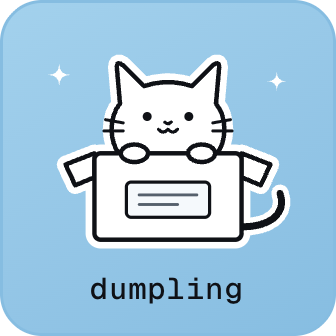

<h3>Hao Li &nbsp;<code>@skyf0cker</code> · <em>Attention is all you need.</em></h3>

  Agent engineer at <strong>ByteDance</strong> focused on <strong>multi-agent collaboration</strong>. 
  Previously DevOps at <strong>Meituan</strong> — building always-on agents, edge routing tools &amp; keyboard-first workflows.

  <strong>Focus</strong> <code>Multi-Agent Collaboration</code> &nbsp;·&nbsp; <strong>Home</strong> <code>:lua print(vim.fn.expand('~'))</code> &nbsp;·&nbsp; <strong>Site</strong> <a href="https://vophan.day">vophan.day</a>

 

<table width="100%">
  <thead>
    <tr>
      <th width="48%" align="left"><code>01 / EXPERIENCE</code></th>
      <th width="52%" align="left"><code>02 / ACTIVE BUILDS</code></th>
    </tr>
  </thead>
  <tbody>
    <tr>
      <td valign="top">
        <strong>ByteDance</strong> · Agent Engineering &nbsp;·&nbsp; <code>2025 — NOW</code> 
        Building AI agent systems; currently exploring multi-agent collaboration &amp; orchestration.
          
        <strong>Meituan</strong> · DevOps Engineering &nbsp;·&nbsp; <code>2021 — 2025</code> 
        DevOps platforms, CI/CD release automation &amp; internal developer infrastructure.
      </td>
      <td valign="top">
        <strong>Valet</strong> &nbsp;<code>BUILDING</code> · Go · TS · Bun 
        Always-on macOS AI butler — event gateway, traces &amp; reversible inbox.
          
        <strong>Tower</strong> &nbsp;<code>BUILDING</code> · Workers · D1 · Hono 
        Cloudflare control plane for Surge, Stash &amp; Clash.Meta routing.
          
        <strong>SpotFocus</strong> &nbsp;<code>BUILDING</code> · Swift · macOS 
        Noise-cancelling for your screen — native macOS focus utility.
      </td>
    </tr>
  </tbody>
</table>

<table width="100%">
  <thead>
    <tr>
      <th width="60%" align="left"><code>03 / AI STACK &amp; WORKBENCH</code></th>
      <th width="40%" align="left"><code>04 / INDEX &amp; CONTACT</code></th>
    </tr>
  </thead>
  <tbody>
    <tr>
      <td valign="top">
        <code>AGENTS&nbsp;&nbsp;&nbsp;</code> &nbsp;<strong>pi</strong> · <strong>fx.sh</strong> · <strong>Muse</strong> AI agents 
        <code>MODELS&nbsp;&nbsp;&nbsp;</code> &nbsp;<strong>Gemini</strong> · <strong>DeepSeek</strong> · <strong>Claude</strong> daily drivers &amp; subs 
        <code>WORKBENCH</code> &nbsp;<strong>Paper Design</strong> · <strong>Zed</strong> · <strong>Rex</strong>
      </td>
      <td valign="top">
        <code>WEB&nbsp;</code> &nbsp;<a href="https://vophan.day">vophan.day</a> ↗ 
        <code>MAIL</code> &nbsp;<a href="mailto:dev@vophan.day">dev@vophan.day</a> ↗ 
        <code>CAT&nbsp;</code> &nbsp;<strong>dumpling</strong> · <em>chief nap officer</em>
      </td>
    </tr>
  </tbody>
</table>
